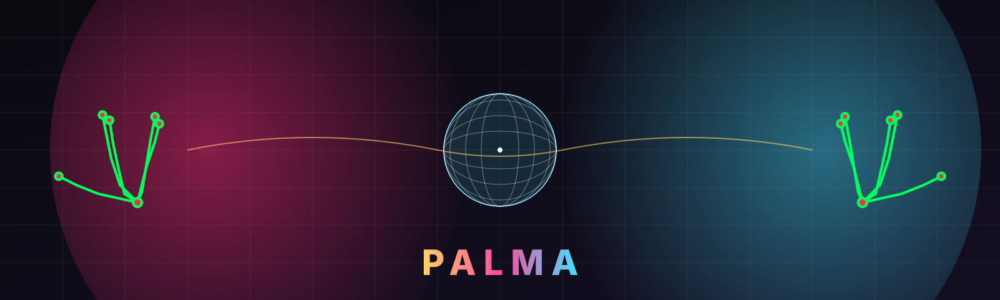
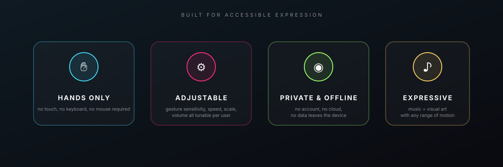
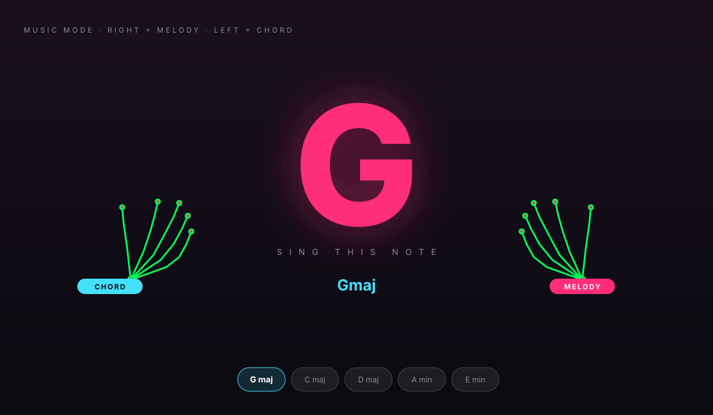
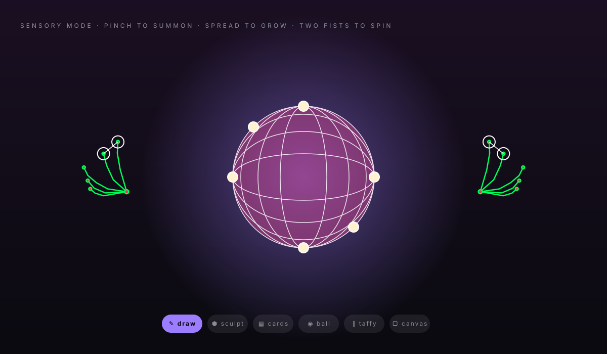
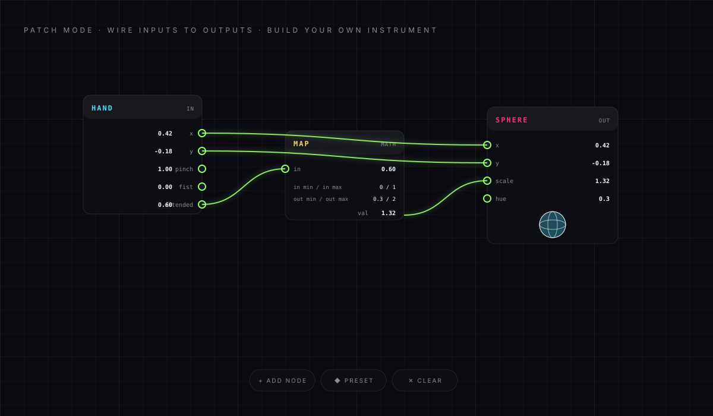
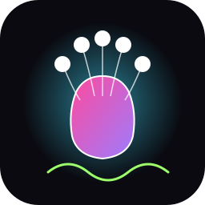

<p align="center">
  
</p>

<h1 align="center">Palma</h1>

<p align="center">
  <strong>Make music. Shape light. With your hands alone.</strong><br/>
  <em>A gesture-driven creative tool for accessible expression.</em>
</p>

<p align="center">
  <a href="#install"></a>
  
  
  
</p>

---

## 🤲 What Palma does

Palma turns your **webcam** into a musical instrument and a 3D sculpting canvas. Move your hands in front of your computer — no keyboard, no mouse, no touchscreen — and sound and light respond in real time.

Palma was built so people with **limited mobility, speech differences, or sensory needs** can create music and visual art together with therapists, educators, and family, using whatever range of motion they have available.

<p align="center">
  
</p>

---

## ✨ The three modes

Press **1**, **2**, or **3** at any time to switch.

### 🎵 Music mode — sing and play together

<p align="center">
  
</p>

A huge letter in the middle of the screen shows the current note so a singer can match pitch. One hand plays a melody, the other holds a chord. **No wrong notes exist** — the scale is locked to a pentatonic that fits every available chord, so any combination of fingers sounds right. Choose a key, pick an instrument sound (piano, pad, pluck, organ, flute), add a metronome, record the session as an audio file.

### 🌀 Sensory mode — hold 3D objects in the air

<p align="center">
  
</p>

Pinch your thumb and index together and a 3D object materializes between your fingers. Spread your fingers wider and it grows. Pinch with both hands and the object stretches between them. Make two fists and it spins. Twelve scene types: wireframe sphere, deformable orb with grab handles, stretchable cards, iridescent taffy, colored metaballs, warp grid, paint trails, air-drawn shapes that auto-fill into solids, and more.

### ◈ Patch mode — build your own instrument

<p align="center">
  
</p>

A visual node graph lets educators or more advanced users wire together their own gesture → sound and gesture → visual mappings. Add nodes from the palette on the left (hand, oscillator, math, sphere, cube, trail, tone), drag outputs to inputs, and the mapping runs in real time. Two preset patches are included as starting points.

---

## 👥 Who Palma is for

| User | How Palma helps |
|------|-----------------|
| **People with motor differences** | Any range of motion — even subtle hand gestures — produces rich sound and visuals. No fine motor precision required. |
| **Non-verbal and minimally-verbal people** | A new channel for expression and communication. Musical and visual output without words. |
| **People with sensory processing needs** | Adjustable intensity, speed, and complexity. Can be used as a calming visual tool or an energizing music maker. |
| **Music therapists** | Group sessions where participants can take turns leading the melody while others sustain chords. All sessions can be recorded. |
| **Occupational therapists** | Encourages purposeful hand movement with immediate rewarding feedback (sound + light). |
| **Educators** | Introduces music theory and visual composition in a tactile, embodied way. Patch mode teaches cause-and-effect through node wiring. |
| **Families** | A shared creative activity that works at any ability level. |

---

## 📦 Install

### Option A — Portable (recommended for care centers)

Download **`Palma-1.0.0-portable.exe`** from the [Releases page](../../releases), copy it to a USB stick or any folder, and double-click. **No installation. No admin rights. No internet needed after download.**

### Option B — Classic installer

Download **`Palma-1.0.0-x64-win.exe`** from the [Releases page](../../releases), run it, pick a folder. Creates desktop + start-menu shortcuts, uninstalls cleanly from *Programs and Features*.

### System requirements

| | |
|---|---|
| **OS** | Windows 10 or 11, 64-bit |
| **RAM** | 4 GB |
| **Camera** | Any built-in or USB webcam |
| **GPU** | Any WebGL-capable (software fallback included for older machines) |
| **Internet** | **Not required** after download |
| **Admin rights** | **Not required** for install |

> ⚠️ **First launch**: Windows may warn "unknown publisher" because the app is not code-signed. Click **More info → Run anyway**. This is normal for independent software.

> 📷 **Camera permission**: Windows will ask once for permission to use the webcam. Click **Allow**.

---

## 🖐 Quick reference card

Print this and keep it next to the computer during sessions.

```
━━━━━━━━━━━━━━━━━━━━━━━━━━━━━━━━━━━━━━━━━
 PALMA · GESTURE REFERENCE
━━━━━━━━━━━━━━━━━━━━━━━━━━━━━━━━━━━━━━━━━

 1 / 2 / 3    switch between Music, Sensory, Patch mode

 MUSIC MODE
   right hand    melody (highest raised finger plays)
   left hand     chord (number of raised fingers)
   SPACE         mute
   R             record audio
   M             metronome on/off

 SENSORY MODE
   🤏  pinch thumb + index    summon object
   ↔   spread fingers          grow it
   🤏🤏 pinch both hands        stretch between them
   ✊✊ close both fists         rotate 360°
   ✊  close one fist            move
   ✕  button top-right          dismiss object
   R                           record video

 PATCH MODE
   click any node in the left menu to add it
   drag OUT (right) → IN (left) to connect
   click an IN pin to disconnect

 F11                           fullscreen
━━━━━━━━━━━━━━━━━━━━━━━━━━━━━━━━━━━━━━━━━
```

French version in [install/LISEZ-MOI.txt](install/LISEZ-MOI.txt).

---

## 🔐 Privacy

- **No account.** No sign-up, no login, no personal information collected.
- **No internet traffic.** After download, the app never contacts a server. All hand tracking runs locally.
- **No data stored.** Sessions are not recorded unless the user explicitly presses **R**, and recordings are saved only to the user's own computer.
- **Camera is only used during the session.** When the app is closed, the camera is released.

This matters for use in care centers where participants' privacy must be protected.

---

## 🛠 Build from source

Palma is open source under the MIT license. Developers can inspect, modify, and rebuild the app.

👉 **Full step-by-step guide (in French): [docs/INSTALL-SOURCE.md](docs/INSTALL-SOURCE.md)**

Short version — requires [Node.js LTS](https://nodejs.org):

```bash
git clone https://github.com/izakk-exe/hand_synth.git
cd hand_synth
install\RUN_DEV.bat   # dev launch (no packaging)
install\BUILD.bat     # produces Palma-x.x.x-x64-win.exe + portable
```

The build script downloads MediaPipe Hands, Tone.js, and Three.js into `vendor/` on first run so the final `.exe` is fully offline.

---

## 📊 Tech stack

| Layer | Library | License |
|-------|---------|---------|
| Shell | Electron 32 | MIT |
| Hand tracking | [MediaPipe Hands](https://google.github.io/mediapipe/) | Apache 2.0 |
| 3D rendering | [Three.js](https://threejs.org) | MIT |
| Audio | [Tone.js](https://tonejs.github.io) | MIT |
| Packaging | electron-builder | MIT |

Hand tracking runs entirely in the browser via WASM — no cloud model inference.

---

## 🤝 For care centers testing Palma

If you'd like to pilot Palma with your participants:

1. **Download** either exe from the [Releases page](../../releases) — the portable version works great on a shared center laptop.
2. **Set up**: a laptop with a webcam, placed so participants can see the screen with their hands in front of them. External monitor + USB webcam often works better than a built-in laptop camera, especially for seated use.
3. **Lighting**: good even lighting helps the hand tracker. Avoid strong backlight.
4. **Session ideas**:
   - **Music mode duets**: participant plays melody, facilitator plays chord (or vice versa).
   - **Sensory relaxation**: use the `taffy` or `ball` scenes with slow music in the background.
   - **Group drawing**: `air draw` scene with two participants making shapes together.
   - **Cause-and-effect learning**: `patch mode` preset "hand → sphere" shows participants their hand movement directly controlling the on-screen object.
5. **Feedback is welcome.** Open an [issue](../../issues) with observations, requests, or stories from your sessions — this directly informs where Palma goes next.

---

## 📝 License

MIT — see [LICENSE](LICENSE). Free to use, modify, redistribute, including in commercial and institutional settings.

---

<p align="center">
  <br/>
  <strong>Built by 1Z4K</strong>
</p>
